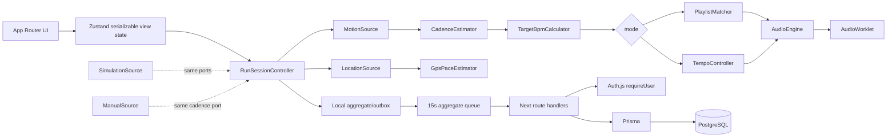
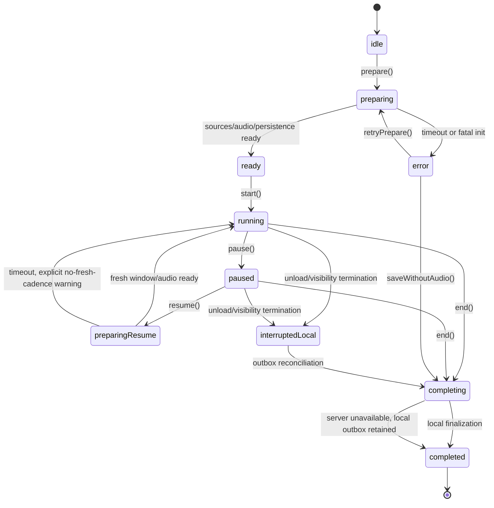

# PULSE — System Architecture

**Current MVP addendum (2026-10-24):** `FUNCTIONAL_MVP.md` records the user-authorized native-media simulator/audio implementation, explicit temporary-storage policy, measured browser evidence boundary, and deviations from this historical full-product plan. See root `IMPLEMENTATION_STATUS.md` for verified status; this specification is not proof that every planned feature exists.

**Status:** Implementation-ready architecture. The main product is not implemented by this preparation step.
**Locked stack:** Next.js App Router, strict TypeScript, Tailwind CSS, GSAP/ScrollTrigger, Motion for React where appropriate, Zustand, TanStack Query where server cache is needed, Web Audio API, AudioWorklet, PostgreSQL, Prisma, Zod, Vitest, React Testing Library, and Playwright.

## Overview

PULSE is a browser-first Next.js application with a server-rendered editorial shell and client-only islands for sensors, local audio, and Simulation. The server owns Auth.js session resolution, user-scoped metadata, history, playlists, and preferences. The client owns high-frequency motion/GPS/audio processing, session orchestration, target calculation, and privacy-preserving aggregation. Typed runtime-agnostic domain modules let deterministic Simulation exercise the same ports as real adapters.

The working tree contains deleted unrelated AskMongo files. Preserve those user changes. Codex must establish the Next.js foundation rather than restore that baseline. No product implementation is implied by this document.

## Repository shape

```text
app/(marketing)/page.tsx                 app/run/new/page.tsx
app/run/[sessionId]/page.tsx             app/history/page.tsx
app/history/[sessionId]/page.tsx         app/library/page.tsx
app/settings/page.tsx                    app/api/sessions/route.ts
app/api/sessions/[id]/metrics/route.ts   app/api/sessions/[id]/complete/route.ts
app/api/sessions/[id]/interrupt/route.ts app/api/history/route.ts
app/api/playlists/route.ts              app/api/preferences/route.ts
components/pulse/{marketing,run,history,library,settings}/
src/domain/{run,sensor,audio,playlist,simulation,shared}/
src/infrastructure/{browser,audio,persistence,auth,telemetry}/
src/server/{auth,db,validation,services}/
prisma/schema.prisma                    public/audio-worklet/tempo-processor.js
__tests__/                               e2e/
```

Server Components must not import browser APIs or Zustand browser state. Browser capability imports stay in adapters. Prisma imports stay in server modules. `Zustand` contains serializable view state only; `AudioBuffer`, `File`, object URLs, raw samples, and worklet nodes stay in lifecycle-managed services.

## Auth boundary

Use Auth.js with Google OAuth in production. `src/infrastructure/auth/auth.ts` configures the provider and secure cookie-backed session. `server/auth.ts` exposes `requireUser()` for protected routes and `getOptionalUser()` for local-only pages. Provision `User` on first authenticated request, using `externalSubject = provider + ":" + providerAccountId` so subject values from separate issuers cannot collide. The server never accepts a user ID from a request body.

Auth.js middleware protects `/api/history`, `/api/playlists`, `/api/preferences`, and server-backed session endpoints. Anonymous Simulation and local library pages use no protected API; a sign-in prompt appears before server persistence. Logout clears the Auth.js session and client query cache. Expiry returns 401, clears pending server mutations, and keeps a local session/outbox available for a later sign-in. A development local adapter is allowed only with `PULSE_AUTH_MODE=development-local`, never in production.

## Layers and ownership

- **Presentation:** pages/components render view models, labels, controls, and accessibility states. GSAP owns marketing scroll timelines; Motion owns local transitions.
- **Run application:** `RunSessionController` owns lifecycle, injected clock, sources, audio policy, local recovery, and low-frequency sync. It calls pure domain engines.
- **Domain engines:** `CadenceEstimator`, `GpsPaceEstimator`, `TargetBpmCalculator`, `TrackAnalyzer`, `PlaylistMatcher`, `TempoController`, `AudioEngine`, and `SimulationEngine` have no React/browser imports and explicit units.
- **Infrastructure:** adapters wrap DeviceMotion, Geolocation, File APIs, Web Audio, storage, visibility, Auth.js, and fetch. Route handlers validate with Zod, authorize, call services, and map typed errors.

## Runtime diagram



## Session state machine

Preparation and starting are separate operations. Readiness is not inferred from a `start()` side effect.



Readiness criteria: selected source is Simulation/Manual or required permission is granted and adapter started; selected local audio is decoded or runner chose muted/no audio; storage/outbox is available; and no fatal capability error remains. `prepare()` has a 12-second timeout. `start()` is valid only from `ready`; a second call in preparing/running/completing is rejected/no-op according to command contract. Resume resets filters, restarts sources, refills audio, and waits one fresh cadence window; it does not reset elapsed time or distance. `interruptedLocal` is a local durable record, not completion.

## Start, interruption, and end sequences

`prepare()` probes without prompting, then the explicit permission action requests selected capabilities. On success it creates or reuses a local session key and may create a server session when authenticated. `start()` captures monotonic and wall-clock start values, sets `running`, and begins aggregate timing.

`pause()` atomically stops active accumulation and freezes target updates. `resume()` enters `preparingResume`, restarts adapters, and returns to running after readiness or a bounded warning. `end()` enters `completing`, stops sources in `finally`, stops/fades audio, calculates aggregates, flushes local data, and submits idempotent completion. Completion succeeds locally when server sync is unavailable and queues a retry.

On `pagehide` or an unrecoverable unload, write an `interruptedLocal` record with local session key, last aggregate, and an interruption idempotency key. Network delivery is best-effort only. On the next foreground visit, the outbox calls `POST /api/sessions/:id/interrupt`; the server accepts the same key once, sets `INTERRUPTED`, and returns the stored result on replay. If no server session exists, the record remains local and is not represented as server history.

Representative pseudocode:

```ts
async function prepare(input: PrepareInput) {
  assertState('idle', 'error');
  state.set('preparing');
  try {
    const caps = await probeCapabilities();
    const grants = await permissions.requestAfterExplicitAction(input, caps);
    await sourceFactory.prepare(input.source, grants, caps);
    await audio.prepareIfSelected(input.audio);
    await localStore.ensureSession(input.clientSessionKey);
    await waitForReadiness({ timeoutMs: 12_000 });
    state.set('ready');
  } catch (error) {
    await stopAllSources();
    state.set('error');
    events.emit(toUserSafeError(error));
  }
}

async function start() {
  assertState('ready');
  state.set('running');
  clock.captureActiveStart();
}

async function saveWithoutAudio() {
  assertState('error');
  state.set('completing');
  await audio.disable();
  await finalizeLocally({ audio: 'unavailable' });
  state.set('completed');
}
```

## Calculations and privacy split

Client-only: raw motion filtering/cadence, raw positions/distance/pace, local decode/BPM/DSP, targets and playlist decisions, display state, and recovery queue. Server-only: auth/ownership, metadata, validated completion aggregates, optional aggregate samples, history, playlists, and preferences. Default upload is one aggregate batch at most every 15 seconds containing elapsed time, cumulative meters, cadence/confidence, pace/confidence, target, source, and sync counters. Never upload raw acceleration, coordinates, or PCM.

## Monitoring and error ownership

Use stable codes: `PERMISSION_DENIED`, `CAPABILITY_UNSUPPORTED`, `SENSOR_LOST`, `GPS_UNAVAILABLE`, `AUDIO_DECODE_FAILED`, `AUDIO_PROCESSOR_FAILED`, `AUDIO_UNDERRUN`, `VALIDATION_FAILED`, `AUTH_REQUIRED`, `SESSION_NOT_FOUND`, `OWNERSHIP_DENIED`, `SYNC_RETRYABLE`, `SYNC_FATAL`, and `INTERNAL_ERROR`. Adapters translate browser errors; domain engines return typed errors; controller decides degradation; routes map validation/auth/db failures; UI maps codes to actions.

Client logs contain code, session correlation ID, capability flags, duration, count, and build version, never raw values, coordinates, PCM, full user agent, or personal filenames. Permission denial is info, repeated underruns/estimator resets are warnings, and unexpected processor/server failures are errors. Remote telemetry is disabled until redaction and sampling are verified.

Route failures: malformed JSON/Zod -> 400 non-retryable; unauthenticated -> 401; missing/wrong ownership -> 404; conflicting idempotency -> 409; out-of-order or too-frequent metrics -> 422; database timeout -> 503 retryable; completed/completion replay -> stored 200. Local completion is not lost when any server request fails.

## Testability and delivery gates

Unit-test pure estimators, scoring, tempo rate limiting, state transitions, validators, and simulation with fake clocks. Integration-test route handlers against PostgreSQL, Auth.js test sessions, ownership, idempotency, browser API mocks, source cleanup, and local outbox. RTL tests accessible status and control behavior. Playwright covers landing, Simulation without permissions, permission denial, lost sensor, local audio privacy, history after sign-in, and responsive/reduced-motion paths.

Before feature work, strict TypeScript, lint/format, Prisma validation, Vitest, RTL, and Playwright smoke must pass. Browser and native boundaries require the device matrix in `FEASIBILITY_REPORT.md`.
